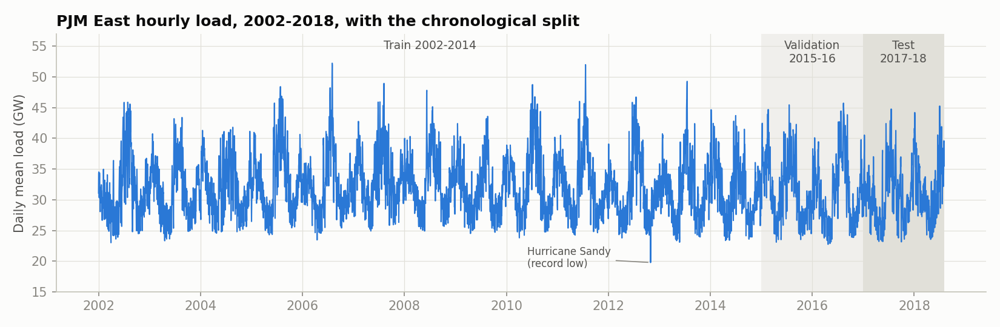
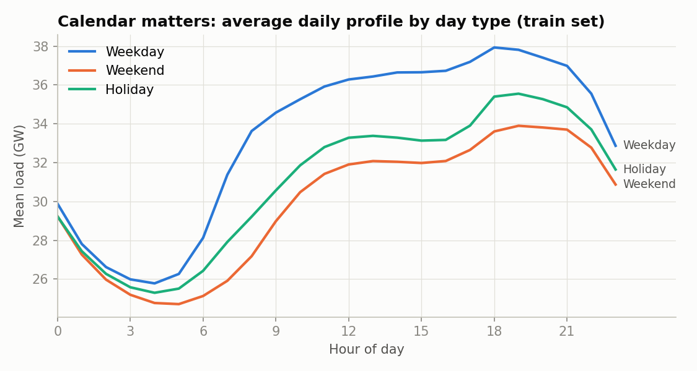
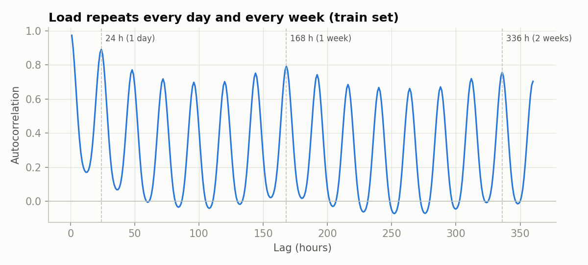

# Core Requirement 2 - Dataset Documentation

All numbers below are produced by the code and can be regenerated:
`data/processed/data_report.json` (preprocessing) and `experiments/split_check.json` (split and leakage checks).

## 1. Dataset choice

**PJM East hourly load (`PJME_hourly.csv`)** from the *Hourly Energy Consumption* collection.

PJM is one of the public load datasets most often used in deep-learning STELF research. Dong et al. (2025, Table 2)
list it among the datasets used in at least 10 studies, with 1-hour sampling. We chose it over the other public
options for these reasons:

* **Long and clean:** 16.6 years of hourly data, no missing values except clock-change artefacts (Sec. 4).
* **One region, one file:** it fits the task (one series + calendar) and trains quickly on student hardware,
  which matters for 3 seeds x several models.
* **Real-world difficulty:** heatwaves, cold snaps, holidays and an extreme event (Hurricane Sandy, Oct 2012),
  which gives us material for the error analysis.

### Report Table 1 - Dataset comparison

| Dataset | Source | Size | Format | Classes | Licence | Role |
|---|---|---|---|---|---|---|
| **PJM East (PJME_hourly)** | PJM Interconnection via Kaggle `robikscube/hourly-energy-consumption` | 145,366 hourly rows, 2002-01-01 -> 2018-08-03, 4.1 MB | CSV: `Datetime`, `PJME_MW` | n/a (regression) | **CC0: Public Domain** (Kaggle dataset page, checked 2026-11-19); original data owner PJM Interconnection LLC | **Train / Val / Test** (only dataset used) |
| ISO-NE (considered) | ISO New England | Hourly load + temperature, 2003-2014 | Excel per year | n/a | ISO-NE terms of use | Not used: needs manual yearly downloads and merging |
| GEFCom2014 (considered) | Global Energy Forecasting Competition | Hourly load + 25 weather stations | CSV | n/a | Competition terms | Not used: set up for probabilistic forecasting, older US utility |
| ENTSO-E (considered) | ENTSO-E Transparency Platform | Hourly load per European country | CSV/API | n/a | ENTSO-E terms | Not used: needs an API token and has more gaps |

The "considered" rows follow the dataset list in Dong et al. (2025, Table 2). They are documented to justify our choice and are not used.

## 2. Source and version

| Item | Value |
|---|---|
| Original data owner | PJM Interconnection LLC, a US Regional Transmission Organization. Values are hourly load in megawatts (MW) for the PJM East region. |
| Primary public release | Kaggle dataset `robikscube/hourly-energy-consumption` (Rob Mulla), file `PJME_hourly.csv` |
| Citable DOI of the same data | IEEE DataPort, "PJM hourly energy consumption", DOI 10.21227/wqg6-9917 |
| Mirror used by `data/download.py` | `github.com/panambY/Hourly_Energy_Consumption`, file `data/PJME_hourly.csv`, last commit `c303f418` (2020-07-04). No Kaggle login needed. |
| **File fingerprint (version pin)** | SHA-256 `4eb2b16d42bf07ec41ab55cb842191594cb69452725a6d3c0991658a628fde84`. The download script refuses any other file, so every team member works on the identical version. |
| Raw size | 145,366 data rows + header, 4,070,265 bytes |
| Software | Python 3.10.12, pandas 2.3.3, numpy 2.2.6, holidays 0.107 (US federal holidays, *observed* dates) |

Raw data is **not** committed to Git (course rule). Run `python data/download.py`.

## 3. What the raw data looks like

* Columns: `Datetime` (local prevailing time, US Eastern) and `PJME_MW` (float).
* Range: 14,544 MW (2012-10-30 04:00, Hurricane Sandy) to 62,009 MW (2006-08-02 17:00, heatwave); mean 32,080 MW.
* **The file is not sorted in time order.**
* No NaN values.
* Strong daily, weekly and yearly cycles: summer (air conditioning) and winter (heating) peaks, see Fig. 1.



## 4. Preprocessing (`data/preprocess.py`)

| Step | What we do | Why | Effect |
|---|---|---|---|
| 1. Sort | Sort rows by timestamp | The raw file is out of order | - |
| 2. Duplicates | Average the two values of a repeated timestamp | When clocks go back (DST end) the 01:00-02:00 hour happens twice | 4 timestamps merged |
| 3. Regular grid | Reindex to a complete hourly grid; fill missing hours by linear interpolation (max 3 h) | When clocks go forward (DST start) one hour does not exist; models need equally spaced steps | 30 single hours filled, flagged in column `imputed` |
| 4. Outlier check | 3-sigma rule on the scaled load (Dong et al., 2025, Sec. 6.1) | Detect suspicious values | 1,263 hours flagged in `flag_3sigma`, **none removed**: they are real heatwave/cold peaks and Hurricane Sandy, exactly the events a forecaster must handle. Removing them would make the test set artificially easy. |
| 5. Calendar features | hour, day-of-week, month, day-of-year as sin/cos pairs; `is_weekend`; `is_holiday` (US federal, observed) | Load depends strongly on the calendar (Fig. 2). sin/cos puts 23:00 next to 00:00 and December next to January. | 10 features (one-hot alternative: 45) |
| 6. Split label | Chronological split (Sec. 5) | No leakage | column `split` |
| 7. Scaling | z-score: (load - mean) / std, **mean and std computed on the training rows only** (mean 32,287.5 MW, std 6,452.9 MW) | Neural nets train better on centred, unit-scale inputs (Dong et al., 2025, Eq. 3); fitting on train only prevents test statistics leaking into training | column `load_scaled`, `data/processed/scaler.json` |

Result: **145,392 hourly rows** (2002-01-01 01:00 -> 2018-08-03 00:00) with no gaps, saved to `data/processed/pjme_processed.csv`.



*Fig. 2 (training data only):* weekday peaks are about 4 GW higher than weekend peaks (37.9 vs 33.9 GW), and holidays
sit in between (35.6 GW). This is the evidence for hypothesis H2.

## 5. Split strategy (leakage-free)

### 5.1 Chronological split. Never shuffled.

| Split | Period | Hours | Share | Holiday days | Samples (windows) | Used for |
|---|---|---|---|---|---|---|
| **Train** | 2002-01-01 01:00 -> 2014-12-31 23:00 | 113,951 | 78.4 % | 144 | 113,760 (one per hour) | Fitting model weights and the scaler |
| **Validation** | 2015-01-01 00:00 -> 2016-12-31 23:00 | 17,544 | 12.1 % | 22 | 731 (one per day) | Hyperparameter tuning, early stopping, model selection |
| **Test** | 2017-01-01 00:00 -> 2018-08-03 00:00 | 13,897 | 9.6 % | 17 | 579 (one per day) | **Final evaluation only, once** |

Why chronological and not random? With random splitting, an hour from 2017 can be in training while the hour right
next to it is in test. The model then "forecasts" by interpolating between known neighbours, and the scores are much
too optimistic. A forecaster can only learn from the past, so the evaluation has to respect time order.
Validation and test each cover whole calendar years (2015-16; 2017 + Jan-Aug 2018), so every season and every
holiday appears in them.

### 5.2 Windowing rules (`src/datasets/windows.py`)

* One sample = **168 past hours in -> 24 future hours out**, with forecast origin t = the first hour predicted.
* A sample belongs to a split **only if all 24 of its target hours lie inside that split**.
* Its 168 input hours may reach back into the previous split. For example, the first validation forecast
  (2015-01-01) reads the last week of December 2014. That is legitimate past information, which a real forecaster
  would also have. The reverse never happens: no input hour comes from a later split.
* Training uses every hour as an origin (stride 1) to get many samples. Validation and test use **one forecast per
  day issued at 00:00** (day-ahead protocol), so every day is scored exactly once and the error analysis can be done
  per day (holidays, heatwaves ...).
* Future calendar features of the 24 target hours are used as inputs. That is allowed because a calendar is known in
  advance. **No weather data is used**, which avoids the trap of using *measured* future temperature that would not be
  available at forecast time.

### 5.3 Automatic leakage checks (`python experiments/check_split.py`)

The script asserts, and fails loudly otherwise, that:

1. every target hour of every sample is inside its own split;
2. no input hour of a sample comes from a later split;
3. the last training target (2014-12-31 23:00) is earlier than the first validation target (2015-01-01 00:00), and the
   last validation target (2016-12-31 23:00) is earlier than the first test target (2017-01-01 00:00);
4. the scaler statistics equal the training-set statistics.

Current result: **ALL LEAKAGE CHECKS PASSED**.

### 5.4 Rules the team follows from now on

* All design decisions (lookback, features, hyperparameters) are made on **train/validation only**. The EDA figures
  2 and 3 use training data only.
* The test set is evaluated **once**, at the end, with the final configuration of each model.
* Every model reads `configs/data.yaml`, so all models share the same split, preprocessing and windows (Core Req. 6).



*Fig. 3 (training data only):* autocorrelation peaks every 24 h. The peak at 168 h (0.79) is higher than its neighbours
at 144 h and 192 h, which shows the weekly cycle. It justifies the 7-day lookback.

## 6. How to reproduce

```bash
pip install -r requirements.txt
python data/download.py            # downloads + verifies SHA-256
python data/preprocess.py          # -> data/processed/*
python experiments/check_split.py  # leakage assertions + sample counts
python experiments/eda.py          # -> experiments/eda/*.png
```

## 7. Ethical and licence notes

* The data is aggregated regional load, so it contains no personal or household-level information.
* **Licence: CC0: Public Domain** (as stated on the Kaggle dataset page `robikscube/hourly-energy-consumption`,
  checked 2026-11-19). CC0 allows copying, modification and use for any purpose without permission; we still credit
  PJM Interconnection LLC as the original data owner and Rob Mulla as the publisher of the Kaggle release.

## Reference

Dong, Q., Huang, R., Cui, C., Towey, D., Zhou, L., Tian, J., & Wang, J. (2025). *Short-Term Electricity-Load Forecasting
by Deep Learning: A Comprehensive Survey.* Engineering Applications of Artificial Intelligence.
https://doi.org/10.1016/j.engappai.2025.110980
